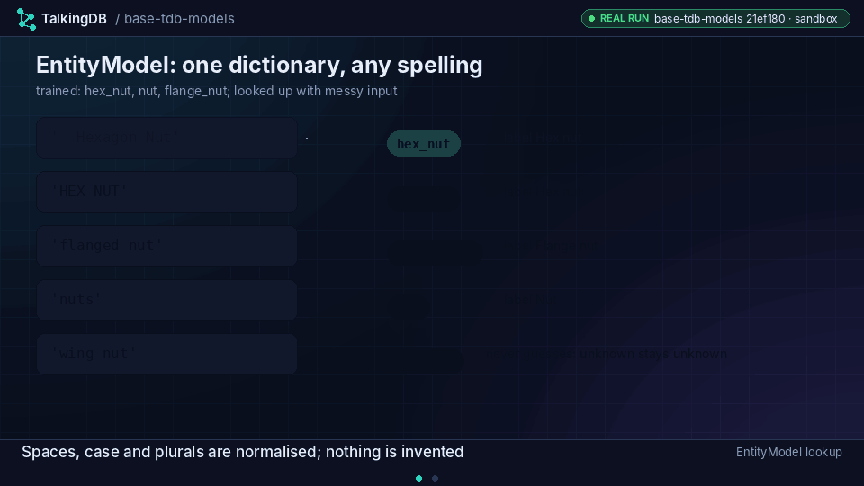

<!-- short-readme -->
<h1 align="center">base-tdb-models</h1>

<p align="center"><b>The shared data shapes every TalkingDB Python service imports.</b></p>

<p align="center"><a href="#try-it">Try it</a> · <a href="docs/architecture.md">How it works</a> · <a href="docs/usage-and-examples.md">Usage and examples</a> · <a href="docs/troubleshooting.md">Troubleshooting</a> · <a href="docs/reference.md">Full reference</a></p>

<p align="center"><a href="https://github.com/TalkingDB/base-tdb-models/stargazers"></a> <a href="https://www.gnu.org/licenses/agpl-3.0.html"></a></p>

<p align="center">
  
</p>
<p align="center"><sub>A real run at <code>21ef180</code> on 27 Nov 2026.</sub></p>

Entities and their synonyms, facts, graphs, documents, jobs and events, as [Pydantic](https://docs.pydantic.dev/) models, with the [SQLite](https://www.sqlite.org/about.html) tables they save to.

## What it does

- **Entities** know every name they go by and look themselves up from messy input ("  Hexagon Nut", "nuts").
- **Facts** link entities, such as `hex_nut subclass_of nut` ([tables](docs/architecture.md)).
- **Jobs** carry a state and a stage, so long work can be tracked and cancelled ([usage](docs/usage-and-examples.md)).

## Try it

```bash
git clone https://github.com/TalkingDB/base-tdb-models.git
cd base-tdb-models
poetry install
```

Other repositories depend on it by Git commit ([how and why](docs/architecture.md#who-depends-on-this-and-at-which-commit)).

## Where it fits

The bottom layer: [base-tdb-clients](https://github.com/TalkingDB/base-tdb-clients), [base-tdb-helpers](https://github.com/TalkingDB/base-tdb-helpers) and every service import it; it imports nothing from TalkingDB.

## Learn more

| Page | Read it to |
| :--- | :--- |
| [How it works](docs/architecture.md) | see the parts and how data moves |
| [Usage and examples](docs/usage-and-examples.md) | copy working examples |
| [Troubleshooting](docs/troubleshooting.md) | fix a problem |
| [Full reference](docs/reference.md) | read everything that used to be on this page |
| [All docs](docs/README.md) | see every page |

## Support TalkingDB

If base-tdb-models saved you time, please [give it a star](https://github.com/TalkingDB/base-tdb-models) ⭐. Stars help other developers find the project.

Found a bug, or a document it gets wrong? [Open an issue](https://github.com/TalkingDB/base-tdb-models/issues/new). We are always here to help and open to a conversation. Explore the TalkingDB applications at [talkingdb.io](https://talkingdb.io/#applications).

## License

Licensed under the GNU Affero General Public License v3.0 ([AGPL-3.0](https://www.gnu.org/licenses/agpl-3.0.html)). See [LICENSE](LICENSE).
