# Architecture

[Docs home](README.md) › Architecture

This page explains how the models in `base-tdb-models` are organised, which [SQLite](https://www.sqlite.org/about.html) tables each one writes, and which TalkingDB repositories depend on it. For a short introduction, start at the [README](../README.md).

## The models at a glance

<picture>
  <source media="(prefers-color-scheme: dark)" srcset="images/model-groups-in-base-tdb-models-dark.svg">
  
</picture>

<sub>Diagram source: [model-groups-in-base-tdb-models.mmd](diagrams/model-groups-in-base-tdb-models.mmd). Edit it and re-render with the steps in [docs/diagrams](diagrams/README.md).</sub>

In words: knowledge models describe what TalkingDB knows, document models describe a parsed file, processing models track background work, and access models describe who is calling.

## File responsibility map

| Folder | Main class | What it holds | Saved to |
| :--- | :--- | :--- | :--- |
| [`entity/`](../talkingdb/models/entity/entity.py) | `EntityModel` | Entities (label plus [surface texts](https://github.com/TalkingDB/ConceptDigger/blob/master/docs/concepts.md#surface-texts-every-name-for-a-thing)) as graph nodes, facts as typed edges, and a reverse index from surface text to entity | `entities`, `facts` |
| [`graph/`](../talkingdb/models/graph/graph.py) | `GraphModel` | A plain directed or undirected graph with JSON attributes on nodes and edges | `nodes`, `edges` |
| [`dictionary/`](../talkingdb/models/dictionary/dictionary.py) | `DictionaryModel` | Word frequencies, suggestions and delete variants used for fuzzy spelling correction | `metadata`, `words`, `deletes` |
| [`rule/`](../talkingdb/models/rule/regex.py) | `RegexModel` | Case insensitive regular expression rules grouped by the entity they belong to | `regex_rules` |
| [`document/`](../talkingdb/models/document/document.py) | `DocumentModel` | A parsed document: layouts, paragraphs, tables, placeholders, heading hierarchy | in memory; indexed by consumers |
| [`document/indexes/`](../talkingdb/models/document/indexes/index.py) | `FileIndexModel` | The outline of a document built from its headings | in memory |
| [`job/`](../talkingdb/models/job/job.py) | `JobModel` | One background ingestion job: state, stage, progress, result, error | `jobs` (store in base-tdb-helpers) |
| [`event/`](../talkingdb/models/event/event.py) | `EventModel` | A record of one processing event such as content elementizing or graph indexing | in memory |
| [`failure/`](../talkingdb/models/failure/failure.py) | `DocumentFailure` | A typed exception plus user facing messages for each failure reason | not saved |
| [`auth/`](../talkingdb/models/auth/) | `UserModel`, `APIKeyModel` | User accounts and hashed API keys | `users`, `api_keys` |
| [`metadata/`](../talkingdb/models/metadata/metadata.py) | `Metadata` | Request scope and tracing fields passed between services | not saved |
| [`factory/`](../talkingdb/models/factory/update.py) | `create_update_model` | Builds PATCH style update models and applies partial updates | not saved |

## How an entity is stored

`EntityModel` keeps everything in a [NetworkX `MultiDiGraph`](https://networkx.org/documentation/stable/reference/classes/multidigraph.html), a graph where two nodes may be joined by more than one directed edge. Each node is an entity. Each edge is a fact, keyed by its `fact_id`, with a `predicate` such as `subclass_of`.

<picture>
  <source media="(prefers-color-scheme: dark)" srcset="images/sqlite-tables-written-by-entitymodel-dark.svg">
  
</picture>

<sub>Diagram source: [sqlite-tables-written-by-entitymodel.mmd](diagrams/sqlite-tables-written-by-entitymodel.mmd). Edit it and re-render with the steps in [docs/diagrams](diagrams/README.md).</sub>

In words: an entity graph is a set of rows in `entities` (one per node) and `facts` (one per edge), all sharing the same `entity_id`.

Three details matter in practice:

1. `save(conn, overwrite=True)` deletes every row for that `entity_id` and writes the graph again. It is a full replace, not a merge.
2. Surface texts are stored exactly as given. The reverse lookup [`get_entities_by_surface_text`](../talkingdb/models/entity/entity.py) lower cases and trims the query, so `"Hexagon Nut "` finds `"hexagon nut"`.
3. One surface text can belong to more than one entity. The lookup then returns every claimant. Deciding which one is meant is the caller's job.

## Job lifecycle

`JobModel` separates **state** (where the job is in its life) from **stage** (which processing step is running). The transitions below are enforced by the job store in [base-tdb-helpers](https://github.com/TalkingDB/base-tdb-helpers/blob/main/talkingdb/helpers/job/store.py).

<picture>
  <source media="(prefers-color-scheme: dark)" srcset="images/jobstate-transitions-dark.svg">
  
</picture>

<sub>Diagram source: [jobstate-transitions.mmd](diagrams/jobstate-transitions.mmd). Edit it and re-render with the steps in [docs/diagrams](diagrams/README.md).</sub>

In words: `COMPLETED`, `FAILED` and `CANCELLED` are terminal; only `FAILED` can go back to `QUEUED`, and only through a bounded retry. While a job runs, `stage` moves through `VALIDATING`, `PARSING`, `ELEMENT_EXTRACTION`, `TREE_GENERATION`, `INDEXING` and `PERSISTING` ([job/stage.py](../talkingdb/models/job/stage.py)).

## Who depends on this, and at which commit

Every consumer pins this package by Git commit in its `pyproject.toml`. As of 25 November 2026 two commits are in use:

| Pinned commit | Consumers |
| :--- | :--- |
| `3295d40` | base-tdb-helpers, package-named-entity-linker, package-content-elementizer, module-ttt |
| `6ad6e83` | package-parse-tree, package-document-search, package-search-trainer, module-ecommerce-ai |

Recheck before relying on it, from a folder holding all the clones:

```bash
grep -n 'base-tdb-models.git' */pyproject.toml
```

## Changing a model safely

A change here is green in this repository and can still break a consumer later, when that consumer bumps its pin.

> [!WARNING]
> Renaming a field, changing a type or changing a default changes what gets stored. SQLite files written with the old shape are not migrated automatically. Check who reads those files before merging.

1. Classify the change: internal only, or part of a stored shape, a function signature or an HTTP response.
2. Search the consumers for the symbol you changed, for example `grep -rn "surface_texts" ../package-*/ ../module-*/ --include=*.py`.
3. For each consumer, note whether its pinned commit includes your change.
4. Bump pins one consumer at a time and run that consumer's tests.

## Keeping these diagrams current

The diagrams on this page are [Mermaid](https://mermaid.js.org/) code, which GitHub draws in the browser. Edit the text and preview it on [mermaid.live](https://mermaid.live) or in your editor's Markdown preview. The GitHub mobile app shows the code instead of the picture, which is why every diagram has an "In words" line under it.

---

**Related:** [Troubleshooting](troubleshooting.md) · [Usage and examples](usage-and-examples.md) · [README](../README.md)
