# base-tdb-models: full reference

[Back to the README](../README.md)

Everything that was on the front page before it was shortened, unchanged apart from links, so nothing is lost.

The shared data shapes that every TalkingDB Python service imports: entities and their synonyms, facts, graphs, documents, jobs and events.


| Start here | Go deeper |
| :--- | :--- |
| [What it is](#what-it-is) | [Architecture: every model and the tables it writes](architecture.md) |
| [Where this fits](#where-this-fits) | [Usage and examples](usage-and-examples.md) |
| [Quickstart](#quickstart) | [Troubleshooting](troubleshooting.md) |
| [What this repo is not](#what-this-repo-is-not) | [Related repositories](#related-repositories) |

All pages: [docs/](README.md).

## What it is

A **model** here is a Python class that describes the shape of one kind of data and, for most models, how that data is saved to and loaded from [SQLite](https://www.sqlite.org/about.html) (a database stored in a single file). This package holds no service and no API. It is a library that the other TalkingDB repositories install and import as `talkingdb.models`.

The most important model is [`EntityModel`](../talkingdb/models/entity/entity.py). An **entity** is one thing TalkingDB knows about, such as "hex nut". Each entity has a **label** (its proper name) and a list of **[surface texts](https://github.com/TalkingDB/ConceptDigger/blob/master/docs/concepts.md#surface-texts-every-name-for-a-thing)**: every way a person might write it ("hex nut", "hexagon nut"). The surface text list is where TalkingDB keeps synonyms. A **fact** is a typed link between two entities, such as `hex nut subclass_of nut`.

## Where this fits

<picture>
  <source media="(prefers-color-scheme: dark)" srcset="images/where-base-tdb-models-fits-dark.svg">
  
</picture>

<sub>Diagram source: [where-base-tdb-models-fits.mmd](diagrams/where-base-tdb-models-fits.mmd). Edit it and re-render with the steps in [docs/diagrams](diagrams/README.md).</sub>

In words: this package is the bottom layer. Helpers, packages and modules import it; it imports nothing from TalkingDB. More detail, including the exact commit each consumer pins, is in [docs/architecture.md](architecture.md#who-depends-on-this-and-at-which-commit).

## Quickstart

You need Python 3.12 or 3.13 and [Poetry](https://python-poetry.org/docs/#installation).

```bash
git clone https://github.com/TalkingDB/base-tdb-models.git
cd base-tdb-models
poetry install
poetry run python -c "from talkingdb.models.entity.entity import EntityModel; print(EntityModel.make_id('Hex nut'))"
```

To use it from another repository, depend on it by Git commit, the way every TalkingDB service does:

```toml
talkingdb-models = { git = "git+https://github.com/TalkingDB/base-tdb-models.git", rev = "<commit sha>" }
```

> [!IMPORTANT]
> Consumers pin this package by commit, so a change here reaches nobody until a consumer bumps its pin. The bump is the risky moment. Read [Changing a model safely](architecture.md#changing-a-model-safely) before you merge a shape change.

## A first example

Create an entity with synonyms, link it to another entity, then look it up by any of its surface texts.

```python
from talkingdb.models.entity.entity import EntityModel

model = EntityModel.create("entity::fasteners")
model.add_entity("hex_nut", label="Hex nut", surface_texts=["hex nut", "hexagon nut"])
model.add_entity("nut", label="Nut", surface_texts=["nut", "nuts"])
model.add_fact("hex_nut", "nut", "subclass_of", fact_id="f1")

print(model.get_entities_by_surface_text("  Hexagon Nut"))
# [{'id': 'hex_nut', 'label': 'Hex nut', 'surface_texts': ['hex nut', 'hexagon nut']}]
```

The lookup ignores case and outer spaces. Saving to SQLite and loading back is shown in [docs/usage-and-examples.md](usage-and-examples.md#save-and-load-an-entity-graph).

## What this repo is not

- **Not a service.** There is no server, port or API here. Services that expose these shapes over HTTP live in the `package-*` and `module-*` repositories.
- **Not a database.** Models write to SQLite files through a connection you pass in. Opening those connections is the job of [base-tdb-clients](https://github.com/TalkingDB/base-tdb-clients).
- **Not a matcher.** Finding entities inside a sentence is done by [package-named-entity-linker](https://github.com/TalkingDB/package-named-entity-linker), which reads these models.
- **Not versioned by release.** Consumers pin a Git commit, not a version number.

## Related repositories

| Repository | Relationship |
| :--- | :--- |
| [base-tdb-clients](https://github.com/TalkingDB/base-tdb-clients) | Opens the SQLite connections these models read and write |
| [base-tdb-helpers](https://github.com/TalkingDB/base-tdb-helpers) | Stores and utilities built on these models (jobs, graphs, auth) |
| [package-named-entity-linker](https://github.com/TalkingDB/package-named-entity-linker) | Trains and matches `EntityModel`, `DictionaryModel` and `RegexModel` |
| [package-parse-tree](https://github.com/TalkingDB/package-parse-tree) | Builds its [ontology](https://en.wikipedia.org/wiki/Ontology_(information_science)) store on `EntityModel` |
| [package-content-elementizer](https://github.com/TalkingDB/package-content-elementizer) | Produces `DocumentModel` from PDF and DOCX files |
| [module-ttt](https://github.com/TalkingDB/module-ttt) | Indexes `DocumentModel` into `GraphModel` and tracks `JobModel` |

## Further reading

- [NetworkX MultiDiGraph](https://networkx.org/documentation/stable/reference/classes/multidigraph.html): the graph type behind `EntityModel`
- [Pydantic documentation](https://docs.pydantic.dev/latest/): the library behind `JobModel`, `EventModel` and `Metadata`
- [Poetry Git dependencies](https://python-poetry.org/docs/dependency-specification/#git-dependencies): how consumers pin this package by commit
- [Entity linking](https://en.wikipedia.org/wiki/Entity_linking): the idea of resolving text to a known entity

## Code contributor

mayank.g@smarter.codes
