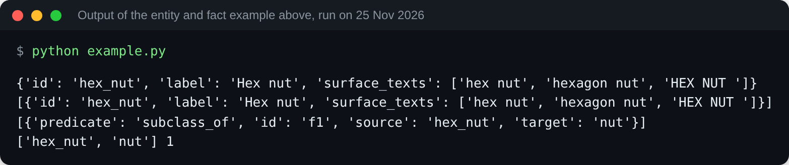

# Usage and examples

[Docs home](README.md) › Usage and examples

Copy and paste recipes for the models people use most. Each example lists what it prints. For the big picture, see [architecture.md](architecture.md).

> [!NOTE]
> The outputs on this page were produced on 25 November 2026 with Python 3.13, pydantic 2.13 and networkx 3.7, against commit `2bfc4a3` of this repository. The `smart-slugify` dependency could not be installed in that environment, so it was replaced by an empty stand in. None of the calls shown here use it; `make_id()` does, so its output is not shown.

## Install as a dependency

Pin a commit in your `pyproject.toml`, the same way the other TalkingDB repositories do:

```toml
[tool.poetry.dependencies]
python = ">=3.12,<3.14"
talkingdb-models = { git = "git+https://github.com/TalkingDB/base-tdb-models.git", rev = "<commit sha>" }
```

While developing several repositories side by side, point at a local checkout instead. Repositories that ship a `Makefile` do this with `make sync MODE=local` (see [base-tdb-helpers](https://github.com/TalkingDB/base-tdb-helpers#keep-git-pins-and-local-checkouts-in-step)).

## Build an entity graph in memory

```python
from talkingdb.models.entity.entity import EntityModel

model = EntityModel.create("entity::fasteners")
model.add_entity("hex_nut", label="Hex nut", surface_texts=["hex nut", "hexagon nut", "HEX NUT "])
model.add_entity("nut", label="Nut", surface_texts=["nut", "nuts"])
model.add_fact("hex_nut", "nut", "subclass_of", fact_id="f1")

print(model.get_entity("hex_nut"))
print(model.get_entities_by_surface_text("  Hexagon Nut"))
print(list(model.iter_facts()))
```

Output:

```text
{'id': 'hex_nut', 'label': 'Hex nut', 'surface_texts': ['hex nut', 'hexagon nut', 'HEX NUT ']}
[{'id': 'hex_nut', 'label': 'Hex nut', 'surface_texts': ['hex nut', 'hexagon nut', 'HEX NUT ']}]
[{'predicate': 'subclass_of', 'id': 'f1', 'source': 'hex_nut', 'target': 'nut'}]
```



<sub>Screenshot of the real command and its unedited output, 25 Nov 2026.</sub>

> [!TIP]
> [Surface texts](https://github.com/TalkingDB/ConceptDigger/blob/master/docs/concepts.md#surface-texts-every-name-for-a-thing) are stored exactly as given, so `"HEX NUT "` sits next to `"hex nut"` as a separate string. Lookups ignore case and outer spaces, so both find the same entity. Normalise before you add if you want a clean list.

## Save and load an entity graph

`init_db` creates the `entities` and `facts` tables. `save` replaces every row for this `entity_id`.

```python
import sqlite3
from talkingdb.models.entity.entity import EntityModel

conn = sqlite3.connect(":memory:")   # use a file path in real code
EntityModel.init_db(conn)
model.save(conn)

print(conn.execute("SELECT entity_id, node_id, label, surface_texts FROM entities ORDER BY node_id").fetchall())
print(conn.execute("SELECT fact_id, source, target, predicate FROM facts").fetchall())

loaded = EntityModel.load(conn, "entity::fasteners")
print(loaded.get_entities_by_surface_text("NUTS"))
```

Output (with the two entity model above, without the `"HEX NUT "` entry):

```text
[('entity::fasteners', 'hex_nut', 'Hex nut', '["hex nut", "hexagon nut"]'), ('entity::fasteners', 'nut', 'Nut', '["nut", "nuts"]')]
[('f1', 'hex_nut', 'nut', 'subclass_of')]
[{'id': 'nut', 'label': 'Nut', 'surface_texts': ['nut', 'nuts']}]
```

In real services, open the connection with [`base-tdb-clients`](https://github.com/TalkingDB/base-tdb-clients) (`get_connection(ENTITY_DB)`), which turns on WAL mode and a busy timeout for you.

## Store a document graph

`GraphModel` is a plain graph with JSON attributes. Module TTT uses it to keep a document's sections, paragraphs and tables.

```python
import sqlite3
from talkingdb.models.graph.graph import GraphModel

g = GraphModel.create("graph::demo", directed=True)
g.graph.add_edge("section:1", "para:1", type="part_of")

conn = sqlite3.connect(":memory:")
GraphModel.init_db(conn)
g.save(conn)
print(GraphModel.load(conn, "graph::demo", directed=True).graph.edges(data=True))
```

Output:

```text
[('section:1', 'para:1', {'type': 'part_of'})]
```

`save` writes in batches of 500 rows by default (`batch_size=`), so other writers can take [SQLite](https://www.sqlite.org/about.html)'s single write lock between batches.

## Track a background job

`JobModel.new` returns a job in state `QUEUED` with a fresh `job::` id. Persisting and moving it through its states is done by the job store in [base-tdb-helpers](https://github.com/TalkingDB/base-tdb-helpers/blob/main/talkingdb/helpers/job/store.py).

```python
from talkingdb.models.job.job import JobModel
from talkingdb.models.job.type import JobType

job = JobModel.new(job_type=JobType.DOCUMENT, filename="report.pdf", namespace="demo")
print(job.state, job.is_terminal())
```

The allowed transitions are drawn in [architecture.md](architecture.md#job-lifecycle).

## Where to look next

| If you want to | Read |
| :--- | :--- |
| See every model and its tables | [architecture.md](architecture.md#file-responsibility-map) |
| Train entities through an API | [package-named-entity-linker](https://github.com/TalkingDB/package-named-entity-linker) |
| Build an [ontology](https://en.wikipedia.org/wiki/Ontology_(information_science)) on top of entities | [package-parse-tree](https://github.com/TalkingDB/package-parse-tree) |
| Turn a PDF or DOCX into a `DocumentModel` | [package-content-elementizer](https://github.com/TalkingDB/package-content-elementizer) |
| Fix an error | [troubleshooting.md](troubleshooting.md) |

---

**Related:** [Architecture](architecture.md) · [Troubleshooting](troubleshooting.md) · [README](../README.md)
